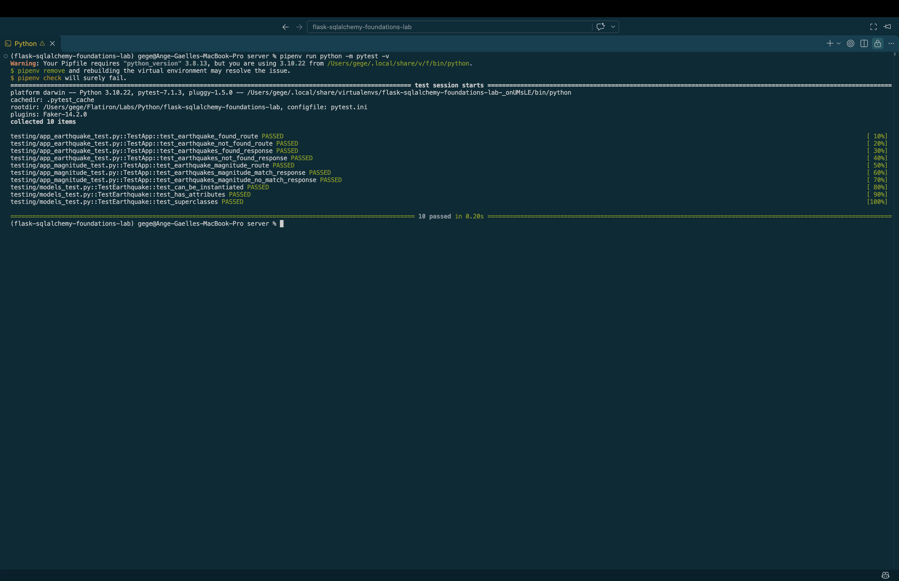

# Flask-SQLAlchemy Foundations – Earthquake Data

## Overview

This project focuses on building a Flask API using SQLAlchemy to store, retrieve, and filter earthquake data.

The application connects to a SQLite database and provides API endpoints for retrieving individual earthquakes and filtering earthquakes by minimum magnitude.

## Technologies Used

- **Python 3.10** – Backend programming language
- **Flask** – Web framework for building API endpoints
- **Flask-SQLAlchemy** – Object-relational mapping (ORM)
- **Flask-Migrate** – Database schema migrations
- **SQLite** – Relational database
- **Pipenv** – Dependency and virtual environment management
- **Pytest** – Automated testing

## Project Structure

```text
flask-sqlalchemy-foundations-lab/
├── server/
│   ├── app.py
│   ├── models.py
│   ├── seed.py
│   ├── migrations/
│   └── testing/
│       ├── models_test.py
│       ├── app_earthquake_test.py
│       └── app_magnitude_test.py
├── Pipfile
├── Pipfile.lock
└── README.md
```

## Lab Sections

### 1. Creating the Earthquake Model

Defined an `Earthquake` model using Flask-SQLAlchemy.

The model contains the following attributes:

- `id` – Integer primary key
- `magnitude` – Float representing earthquake magnitude
- `location` – String representing where the earthquake occurred
- `year` – Integer representing the year of the earthquake

Implemented a `__repr__()` method to provide a readable representation of earthquake records.

Example:

```python
<Earthquake 1, 9.5, Chile, 1960>
```

### 2. Database Migrations

Configured Flask-Migrate to manage changes to the database schema.

Created and applied the initial migration to generate the `earthquakes` table.

### 3. Seeding the Database

Used `seed.py` to populate the database with five historical earthquakes.

The seed data includes earthquakes from Chile, Alaska, and the Banda Sea.

### 4. Retrieving an Earthquake by ID

Created the following API endpoint:

```http
GET /earthquakes/<int:id>
```

This endpoint retrieves an earthquake by its ID and returns its information as JSON.

Example response:

```json
{
  "id": 1,
  "location": "Chile",
  "magnitude": 9.5,
  "year": 1960
}
```

If the requested earthquake does not exist, the API returns a `404 Not Found` response.

Example:

```json
{
  "message": "Earthquake 9999 not found."
}
```

### 5. Filtering Earthquakes by Magnitude

Created the following API endpoint:

```http
GET /earthquakes/magnitude/<float:magnitude>
```

This endpoint retrieves all earthquakes with magnitudes greater than or equal to the requested value.

Example request:

```http
GET /earthquakes/magnitude/9.0
```

Example response:

```json
{
  "count": 2,
  "quakes": [
    {
      "id": 1,
      "location": "Chile",
      "magnitude": 9.5,
      "year": 1960
    },
    {
      "id": 2,
      "location": "Alaska",
      "magnitude": 9.2,
      "year": 1964
    }
  ]
}
```

## SQL Concepts

### Object-Relational Mapping (ORM)

Used SQLAlchemy to represent database tables as Python classes, allowing database records to be accessed and manipulated through Python objects.

### Primary Keys

Defined a unique integer `id` for each earthquake record.

### Database Queries

Used SQLAlchemy queries to retrieve individual records and filter records based on specified conditions.

### Comparison Operators

Used the `>=` operator to filter earthquakes with magnitudes greater than or equal to a given threshold.

### Database Migrations

Used Flask-Migrate to create and update the database schema without manually writing SQL table-creation statements.

## Installation and Setup

### 1. Clone the Repository

```bash
git clone git@github.com:a-gbatie/flask-sqlalchemy-foundations-lab.git
cd flask-sqlalchemy-foundations-lab
```

### 2. Install Dependencies

```bash
pipenv install
```

### 3. Activate the Virtual Environment

```bash
pipenv shell
```

### 4. Navigate to the Server Directory

```bash
cd server
```

### 5. Configure Flask

```bash
export FLASK_APP=app.py
export FLASK_RUN_PORT=5555
```

### 6. Initialize the Database

For a fresh setup without existing migrations:

```bash
flask db init
flask db migrate -m "initial migration"
flask db upgrade head
```

If the repository already contains a `migrations/` directory, only run:

```bash
flask db upgrade head
```

### 7. Seed the Database

```bash
python seed.py
```

### 8. Start the Flask Server

```bash
python app.py
```

The application runs at:

```text
http://127.0.0.1:5555
```

## Testing

From the project root, run:

```bash
pipenv run python -m pytest -v
```

Individual test files can be executed using:

```bash
pipenv run python -m pytest server/testing/models_test.py -v
pipenv run python -m pytest server/testing/app_earthquake_test.py -v
pipenv run python -m pytest server/testing/app_magnitude_test.py -v
```

## Screenshot of Completed Tests
